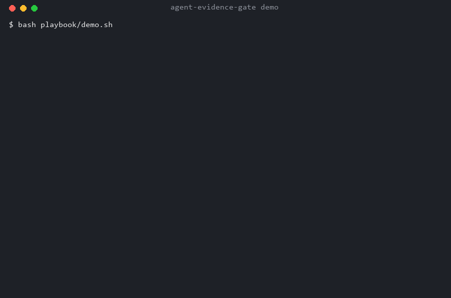

# Evidence Gate for Lightweight LLM Agents

> Put uncertainty into structure, not into prompting.



A dependency-free Python task bus that makes small, cheap models reliable enough to run unattended — a SQLite state machine with leases, **evidence gates**, approval gates and byte-budgeted context packets, plus a 21-item anti-pattern playbook distilled from real failures.

**What it is:** the layer that decides *who does the task, whether the result can be trusted, and what happens when a worker dies.*
**What it is not:** another agent framework, a group chat, or a replacement for your runtime.

---

## Why not just prompt better?

A lightweight model saying "done" is a claim, not a fact. You cannot make reliability by telling a smaller model to be more careful — you make it by defining what counts as done, and refusing to move the state machine until the disk proves it.

| Failure mode | What this repo does |
|---|---|
| The same task runs twice | `client_nonce UNIQUE` + atomic `claim` (`BEGIN IMMEDIATE`) |
| A worker crashes and the task hangs forever | `lease_until` + `reap`; `attempts` capped, then `dead` |
| The agent says "finished", the artifact is empty/stale | Evidence gate: file exists → sha256 matches → command + exit code → stdout hash |
| Upstream dumps 10 KB into the next agent's prompt | Packet with byte caps per slot; oversized slots are dropped and recorded |
| A task that sends messages or spends money just runs | Four approval classes: `outbound`, `spend`, `delete`, `permission` |
| Handoff relies on someone remembering | Five-column handoff written atomically into `inbox/` |

---

## Quick start (30 seconds, no dependencies)

```bash
git clone https://github.com/wheelcog778/agent-evidence-gate
cd agent-evidence-gate
python selftest.py      # 30 assertions against the real state machine
python e2e.py           # researcher → verifier → reviewer, real files, real gate
```

`selftest.py` needs only the standard library. Nothing is mocked: every assertion runs the CLI and checks exit codes, database state and artifacts on disk.

---

## Core concepts

### 1. Evidence gates

"File exists" is not evidence. A gate has four layers:

1. artifact exists, is a regular file, and lives inside the task's own `work/`
2. declared `sha256` is present and matches
3. every artifact points to the command that produced it
4. that command's `stdout` is a real file with a matching hash; a non-zero outer exit code fails immediately

What is actually unforgeable is the runner's own `runlog` and the outer exit code. The rest makes forgery visible and auditable — not mathematically impossible. This README and the design notes say so on purpose.

### 2. Handoff protocol

```
| time | what upstream asked (verbatim) | what I did | artifact paths | next first step |
```

Written inside the transaction and appended to `inbox/<date>-<agent>.md` with a block marker, so a retry replaces its own block instead of appending a second one.

### 3. Context budget

Four slots, hard byte caps:

| Slot | Cap | Content |
|---|---:|---|
| task | 3072 B | the task card |
| upstream | 2048 B | upstream handoff (five columns only — not its reasoning) |
| brief | 1536 B | `profiles/<agent>.md` |
| rules | 1024 B | `RULES.md` |

Measured on the bundled pipeline: 1,660 B vs 11,173 B (−85.1%) for a one-level verification task, 1,900 B vs 14,014 B (−86.4%) at depth two. Root tasks save nothing — reported honestly as `comparable: false`.

### 4. Architecture

```
        ┌──────────── control plane (disk) ─────────────┐
        │  task table (state machine + lease + evidence) │
        │  event table (append-only audit)               │
        │  handoff table (five columns)                  │
        └───────┬───────────────────────┬────────────────┘
                │ submit / claim        │ packet (budgeted)
                ▼                       ▼
        ┌──────────────┐        ┌───────────────┐
        │ runner       │───────▶│ agent process │
        │ isolated work│        │ reads packet  │
        │ checks manifest◀──────│ writes artifact│
        └──────────────┘        └───────────────┘
                │
                ▼
        evidence gate → done / fail (no verbal pass)
```

State machine:

```
queued ──claim──▶ claimed ──start──▶ running ──done──▶ done
  ▲                  │                  │
  │                  │ lease expired    ├──fail──▶ failed / dead (attempts exhausted)
  └────── reap ──────┘                  └──block─▶ blocked_on_human ──approve──▶ queued
                                                          └──deny──▶ cancelled
```

Terminal states cannot be resurrected; `runner` refuses to start anything that is not `running`, unexpired, approved and within deadline; `fail --retry` cannot bypass approval.

---

## The 21 anti-patterns (excerpt)

Every item comes from a real incident. Full list: [`playbook/docs/避雷清单.md`](playbook/docs/避雷清单.md) (Chinese) — format is *symptom → consequence → fix → where it bit us*.

1. **Verifying "the file exists" is not verifying anything.** The first version of the gate did only this, and a model review judged it FAIL.
2. **A command string means "trust me".** `manifest.commands: ["python run.py"]` is a claim. Make it `{cmd, exit_code, stdout_path, stdout_sha256}`.
3. **Timestamps in a hashed output make reproducibility a lie.** Keep them in a separate file.
4. **Not gating on the outer exit code.** Write a self-consistent manifest, then `exit(1)` — five lines plug the biggest hole.
5. **Loose assertions let tests lie for you.** Require the positive string *and* the absence of `Traceback`.

The other 16 cover terminal-state resurrection, approval bypass via `--retry`, duplicate outbound messages, DB/file divergence, multi-agent context pollution, supervisor-LLM orchestration, routing by display name instead of immutable ID, and treating tokens as proof of authenticity.

Practical advice from the playbook: do not adopt all 21 at once. Start with numbers 1–5; add the rest when they actually bite.

---

## Comparison

Market snapshot (November 2026, GitHub search):

| Query | Top projects | Stars |
|---|---|---|
| `agent task queue sqlite` | mission-control, opencode-supertask, aqm | 35 / 13 / 13 |
| `agent evidence verification` | teaql-agent-kit, Aegis, attestix | 2,818 / 1,422 / 685 |

The "task queue" shape tops out at two digits — people do not think it is a problem. "Can I trust what the agent produced" reaches four digits — people have been burned. This repository is positioned as the second one.

| | CrewAI / AutoGen / MetaGPT | LangGraph | OMA | agent-evidence-gate |
|---|---|---|---|---|
| Who talks next | ✅ | ✅ | ✅ | ➖ deterministic runner |
| Idempotent submit | ❌ | manual | ✅ | ✅ |
| Lease + crash reaping | ❌ | ❌ | ✅ | ✅ |
| Command-level evidence | ❌ | ❌ | ❌ audit events only | ✅ |
| Context byte budget | ❌ | ❌ | ❌ | ✅ |
| Terminal-state protection | ❌ | ❌ | — | ✅ |
| Cross-machine | varies | varies | ✅ | ❌ SQLite, single host |
| Ecosystem | large | large | 7k★ | none |

If OMA already covers you, use OMA — it is stronger on ecosystem and distribution. This repo's two differentiators are context budgeting and command-level evidence.

### When not to use this

- The task runs once and you are watching → call the API directly.
- You need multi-machine or high concurrency → SQLite is the wrong substrate.
- You want the agent to plan for itself → this project deliberately does not do planning.
- Every step is reviewed by a human anyway → you are the evidence gate.

---

## Repository layout

```
agent-evidence-gate/
├── bus.py                 # CLI: submit/claim/start/evidence/done/fail/block/approve/reap/packet/handoff
├── runner.py              # isolated work dir, runs the agent, verifies the manifest
├── context.py             # four-slot byte-budgeted packet
├── selftest.py            # 30 assertions, stdlib only
├── e2e.py                 # three-agent pipeline on real files
├── pack.py                # snapshot the repo with hashes
├── bridge_handoff.py      # write handoff blocks into inbox/
├── bridge_kanban.py       # mirror Hermes kanban cards into the bus (idempotent)
├── demo/                  # three demo agents
├── profiles/              # role briefs (researcher, verifier)
├── RULES.md               # hard constraints injected into every packet
└── playbook/              # 21 anti-patterns, lightweight-model rules, checklists, templates
```

## Status and known gaps

- 30/30 selftest assertions pass on the committed tree (2026-11-08).
- The manifest is still written by the agent: the runner cannot observe which command inside the child process produced which file. Only `runlog` and the outer exit code are unforgeable.
- The handoff file write and the DB commit still have a small window; a full fix is an outbox table with replay.
- No push/subscription — workers poll `claim`.
- No cross-machine support. No approval UI (CLI only).

These are listed because a reliability project that hides its own gaps is the joke it is trying to prevent.

## Commercial support

Consulting on production agent pipelines — audits of retry/idempotency, approval design, and evidence gates that actually gate. Open an issue with the `consulting` label.

## License

MIT. See [LICENSE](LICENSE).

## Contact

Author: Q洗Y烟机 · 753073396@qq.com
