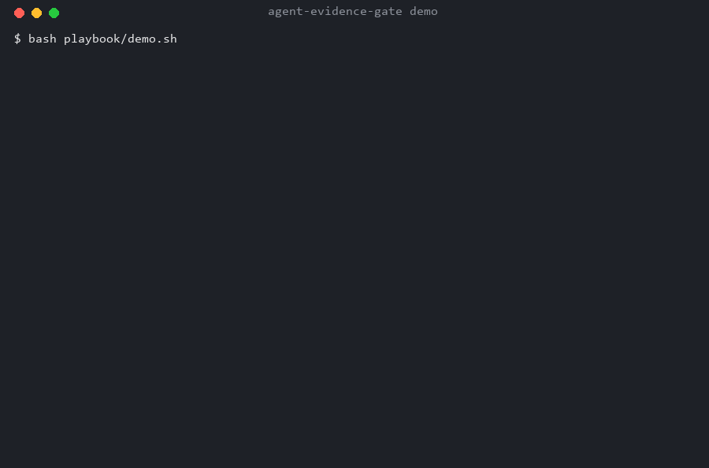

# 证据门：让轻量模型跑得住的多智能体底座

> 把不确定性压进结构里，而不是指望模型自己稳。



轻量任务总线：让多个 agent 在磁盘上协作，而不是在聊天窗口里互相污染上下文。零依赖 Python，SQLite 状态机 + 租约 + 证据门 + 审批门 + 预算式上下文包，外加一份 21 条避雷清单。

**它是什么**：决定「任务该谁做、结果能不能信、崩了怎么办」的那一层。
**它不是什么**：不是框架，不是群聊，不替代你的 runtime。

---

## 为什么不是"又一个多智能体框架"

CrewAI / AutoGen / MetaGPT 解决的是"几个 LLM 谁先说话"。真实团队出问题的地方不在这：

| 失效模式 | agent-bus 的答案 |
|---|---|
| 同一个任务被两个 worker 跑了两遍 | `client_nonce UNIQUE` + 租约互斥 |
| worker 崩了，任务永远挂着 | `lease_until` + `reap`，attempts 有上限 |
| agent 说"做完了"，其实没产物 | 证据门：文件必须存在且 sha256 未变 |
| agent 把上游 10KB 长文全吃进上下文 | packet 按字节预算裁剪，只给结论与路径 |
| 会发外部消息/花钱的活直接执行了 | 四类审批门，超时即拒 |
| 交接靠人记住 | handoff 五列自动落到 `handoff/inbox` |

---

## 架构

```
        ┌──────────── 控制面（磁盘） ────────────┐
        │  task 表 (状态机 + 租约 + 证据)         │
        │  event 表 (append-only 审计)            │
        │  handoff 表 (五列交接)                  │
        └───────┬─────────────────┬──────────────┘
                │                 │
     submit/claim│                │packet（预算裁剪）
                ▼                 ▼
        ┌──────────────┐   ┌──────────────┐
        │ runner       │──▶│ agent 进程    │
        │ 隔离 work/   │   │ 只读 packet   │
        │ 收 manifest  │◀──│ 写产物+清单   │
        └──────────────┘   └──────────────┘
                │
                ▼
        证据门 → done / fail（不许空口通过）
```

### 状态机

```
queued ──claim──▶ claimed ──start──▶ running ──done──▶ done
  ▲                  │                  │
  │                  │ lease 过期        ├──fail──▶ failed / dead(attempts 用尽)
  └────── reap ──────┘                  └──block─▶ blocked_on_human ──approve──▶ queued
                                                          └──deny──▶ cancelled
```

四条硬约束（v0.1 修完 Codex 审出的漏洞后）：
- **终态不可逆**：`done` / `failed` / `dead` / `cancelled` 不能被 `block` 拉回去，也不能被 `approve` 复活
- **runner 只跑 `running`**：state 不对、租约过期、审批未过、超期，一律拒绝启动（副作用之前拦）
- **`fail --retry` 不能绕过审批**，attempts 用尽后无条件 `dead`
- **`evidence` 只接受普通文件**，目录的空 hash 过不了门

---

## 它能做什么（功能清单）

**调度**
- 提交任务：`submit`，带 `client_nonce` 幂等——同一条任务重投一百次也只有一条
- 建依赖：`--parent` 形成因果链，`--max-depth` 限递归深度（默认 4）
- 优先级 + 截止时间：`--priority` / `--deadline`，到期自动判失败，不无限挂着
- 原子认领：`claim` 用 `BEGIN IMMEDIATE`，多个 worker 并发只有一个拿到
- 租约：`--lease` 秒数，worker 崩了 `reap` 会回收，`attempts` 用尽自动 `dead`

**证据**
- `evidence` 登记文件并算 sha256，之后文件被改就永远过不了 `done`
- 证据门 v4：命令必须是对象、stdout 必须是真文件、产物必须落在自己的 work/ 内、
  sha256 必填、每个产物指向生成它的命令、外层退出码非零直接失败
- 证据登记的是 runner 的 `verification.json`（含真实 cmdline / exit_code / 耗时 /
  stdout 的 sha256），不是 agent 的自述

**审批**
- 四类动作必须人工批：`outbound`（发消息/发布）、`spend`（花钱）、
  `delete`（删除覆盖）、`permission`（改权限）
- 提交即 `blocked_on_human`，未批不可认领；`approve` 才回队列，`deny` 直接取消

**上下文（"少吃"）**
- 四槽预算：task 3072B / upstream 2048B / brief 1536B / rules 1024B
- 超预算的槽整体丢弃并记进 `dropped`，不静默截断
- 上游只给五列结论，不给上游的完整思考过程
- 量化：`used_bytes` vs `full_history_bytes`，省多少一目了然（实测 83–86%）

**执行**
- `runner.py`：一个任务一个隔离 `work/` 目录，跑子进程、超时杀掉
- 支持 `{ROOT}` / `{WORK}` 占位符（因为 cwd 是隔离目录）
- 自动校验 manifest，过了才置 `done`，不过就 `fail` 并写明原因

**交接**
- `handoff`：写五列（时间 / 上游要什么 / 我做了什么 / 产出路径 / 下次第一步）
- 自动追加到 `handoff/inbox/<日期>-<agent>.md`，带块标记，同一任务重写只替换不追加
- 能回写 `交接/任务板.md` 的「下次第一步」列（`source=board:T-xxx` 时）

**融合**
- `bridge_kanban.py mirror`：把 Hermes crew 里未结束的卡导入总线（幂等）
- `bridge_kanban.py diff`：两边状态对照
- `bridge_kanban.py push`：把总线终态写回 kanban 评论（默认只打印命令，`--exec` 才真写）
- 导入时只取标题 + 前 1200 字节，不把几 KB 的 body 塞进 agent 上下文

**审计**
- `event` 表 append-only：提交、认领、开始、证据、完成、失败、回收、审批、交接、推送
- `status --id` 一次看全：任务字段 + 全部事件
- `runs/<id>/` 里留着 packet、指令、stdout、stderr、runlog、verification、result

---

## 快速开始

```bash
cd agent-evidence-gate

python bus.py init
python bus.py submit --agent researcher --title "读 X" \
    --payload '{"target":"C:/path/to/file.md"}' --nonce my-001

python bus.py claim --agent researcher --lease 900   # 拿一张卡
python bus.py start --id <task_id>                    # 租约有效才允许
python runner.py --id <task_id> --cmd 'python "{ROOT}/demo/agent_research.py"'
```

`runner.py` 会自动：建 `runs/<id>/work/`、写 `packet.json` + `INSTRUCTIONS.md`、
跑 agent、校验 `manifest.json`、过证据门、置 `done`。

---

## 命令表

| 命令 | 作用 |
|---|---|
| `submit` | 提交任务；`--nonce` 幂等；`--parent` 建因果链；`--require-approval` 直接 blocked |
| `claim` | 原子认领（`BEGIN IMMEDIATE`），带租约 |
| `start` | claimed → running |
| `evidence` | 登记证据文件并记 sha256 |
| `done` | 过三关门（证据存在/未篡改、审批已批、未超期）才允许 |
| `fail` | 失败；`--retry` 回队列；attempts 用尽自动 dead |
| `block` / `approve` | 人工卡点 |
| `reap` | 回收过期租约、超期任务 |
| `packet` | 打印该 agent 能看到的上下文（含预算与省了多少） |
| `handoff` | 写五列交接，同步 `handoff/inbox`，回写看板的「下次第一步」 |

---

## 和现有体系的融合

### 1. `AGENTS.md` §5 交接协议

`bus.py handoff` 生成的就是同一张表：

| 时间 | 上游要什么（原话） | 我做了什么 | 产出绝对路径 | 下次第一步 |
|---|---|---|---|---|

差异只有一处：**机器会在下一次交接时自动覆盖同一 task 的块**（靠 `<!-- agent-bus:handoff:<id> -->` 标记），
不会像手工追加那样越写越长。任务板里 `T-xxx` 的「下次第一步」也会被回写（`source=board:T-xxx` 时）。

### 2. Hermes crew（kanban）

```bash
python bridge_kanban.py mirror --dry     # 看会导入哪些卡
python bridge_kanban.py mirror           # 导入 bus（幂等）
python bridge_kanban.py diff             # 两边状态对照
python bridge_kanban.py push             # 打印回写命令；--exec 才真写
```

定位：**kanban 是任务来源与审计归档，bus 是执行层**。
kanban 的 body 经常几 KB，`mirror` 只取标题 + 前 1200 字节 + workspace 路径，
避免把整段历史塞进 agent 上下文。

### 3. GUI agent（没有 CLI）：接力桥

有的 worker 根本不能跑命令——桌面聊天应用、浏览器里的模型、人手工敲的窗口。它不能 claim、
不能交证据，但任务还是要过同一道门。`bridge_relay.py` 顶替它在状态机里的位置：

```bash
python bus.py submit --agent gui-worker --title "验收这份文档" --payload '{"expected_artifact":"report.md"}'
python bridge_relay.py dispatch --id t_xxx    # 代 claim + start，渲染 BRIEF.md，派单时刻建快照
# 把 relay_inbox/t_xxx.md 的首行粘进那个窗口
python bridge_relay.py collect  --id t_xxx    # diff 快照、复制证据、登记、done
```

所有权仍是单写者：`claim --agent gui-worker --owner relay`，worker 全程不碰总线。
`collect` 只认「派单时不存在、且 mtime 严格晚于派单」的文件，其余进 `stale_rejected`；
另写一条 `relayed` 事件（`worker_ran_bus: false`）留痕。完整说明，包括快照**不能**证明什么：
[`docs/relay-bridge.md`](docs/relay-bridge.md)。

---

## 上下文预算（"少吃上下文"）

`context.py` 只装四个槽，按字节裁剪：

| 槽 | 上限 | 内容 |
|---|---|---|
| task | 3072B | 任务卡本身 |
| upstream | 2048B | 上游 handoff 五列（不带上游的思考过程） |
| brief | 1536B | `profiles/<agent>.md` 岗位说明 |
| rules | 1024B | `RULES.md` 硬规则 |

超预算的槽整体丢弃并记入 `dropped`，不静默。
`full_history_bytes` 是对照组：不走 packet 时，agent 为了接住这张卡必须读的
（祖先 payload + handoff + 上游产物文件 + 证据文件）字节数。

实测（`e2e.py` 第 4 轮）：

| 任务 | packet | 全量 | 省 |
|---|---:|---:|---:|
| verifier 核验上游 report（1 层） | 1,660 B | 11,173 B | 85.1% |
| 模型复核（2 层） | 1,900 B | 14,014 B | 86.4% |

链路越深、上游产物越大，省得越多；根任务不省（brief/rules 是固定成本，已标 `comparable: false`）。

---

## 证据门 v4：命令不是一句话，是一条可复算的链

旧版只验「文件在 + hash 对」，结果模型复核直接判 FAIL：

> sha256 只给出结果值，没有产生它的命令行与终端回显，按硬规则不可采信。

v2 的 `manifest.commands` 每条必须是对象：

```json
{
  "cmd": "python -c \"...hasattr...\" \"C:/path/file.md\"",
  "exit_code": 0,
  "stdout_path": "logs/cmd-sha256.log",
  "stdout_sha256": "c90f62c6…"
}
```

门禁规则（`runner.verify_manifest`，缺一不可）：

1. `artifacts` 非空，每个 path **落在自己的 `work/` 内**、是普通文件、`sha256` **必填**且一致
2. 每个 artifact 必须带 `produced_by`（指向生成它的命令下标）
3. `commands` 必须是对象数组，`cmd` 非空 —— 字符串形式的「我跑过 X」直接拒
4. 每条命令的 `stdout_path` 在 `work/` 内、是普通文件、sha256 与声明一致
5. 至少一条命令 `exit_code == 0`
6. `verdict` 非空
7. **外层进程 `exit_code != 0` 时直接失败，不进入 manifest 门**（否则写一份自洽清单再 exit(1) 就能骗过）

并且 **evidence 登记的是 runner 的 `verification.json`，不是 agent 自己写的 manifest**。
`verification.json` 里含 runner 独立记录的 `runlog`（真实 cmdline、exit_code、耗时、
stdout/stderr 的 sha256），agent 改不到——它在 `runs/<id>/` 下，不在 `work/` 下。

### 这层门的边界（不吹）

manifest 由 agent 写，所以"这条命令真的产生了这个文件"runner 无法从外部观测。
**真正不可伪造的是两样**：runner 的 `runlog` 与**外层退出码**。
其余是让伪造变得可见、可审计，而不是数学上不可能。

早先试过"每轮随机 token 写进环境变量让 manifest 回显"，后来自己删了——
agent 能读环境变量，那只是防重放，不是防伪造。留着会让人误以为更安全。

### 最终实验（第 4 轮）

```
researcher  t_dc75d532dc05  ok=True  ctx=1291B
verifier    t_e9ad96e68b65  ok=True  ctx=1660B/11173B saved=0.851
verifier-llm t_55b051b55747 ok=True  ctx=1900B/14014B saved=0.864
```

模型复核结论：**三项全 PASS**，并自己做了交叉验算：

> 证据标题清单 11 行中，以 `## ` 开头者为 10 行，恰等于 `[6]` 的 10，且 11−1=10 与 `[2]` 的 11 自洽。

同一道题，第 1 轮判三项全 FAIL，第 2 轮判「路径 PASS、命令 FAIL、口径 FAIL」，
第 3 轮指出 stdout 截断自相矛盾，第 4 轮全 PASS。**每一轮的意见都是对的，每一轮都改了东西。**

---

## 验证

```bash
python selftest.py     # 30 项断言，全过才返回 0
python e2e.py          # 真链路：researcher → verifier → 模型复核
```

`e2e.py` 只有最后一步调模型。没设 `BUS_LLM_KEY`（或 `OPENAI_API_KEY` / `QWEN_API_KEY`）时该步打印 `SKIP: 模型通道不可用`，其余照跑，不算失败。

覆盖：幂等、租约互斥、证据门（缺失/篡改）、审批门、租约回收、attempts 上限、
researcher→verifier 全链路、handoff 落盘、packet 预算、kanban mirror、
证据门的三条负数用例（字符串命令 / 缺 produced_by / stdout 被改）、
v4 的三条（artifact 缺 sha256 / stdout 是目录 / 路径穿越）、
Codex P0 的五条端到端（runner 拒非 running / block 不复活终态 / 目录当证据 / 审批绕过 /
外层 exit≠0 不许 done）、并发三条（push 抢占 / handoff 不重复块 / 读事务）。

最近一次：**30/30 PASS**（2026-11-08）。

---

## 已知缺口

**外部审查（Codex 0.163，2026-11-08）**：7 条 P0 全修 + 4 条 P1 已修（并发相关的三条、
demo 的 `shell=True`）。逐条在 `codex-review.md` 对照，`selftest.py` 里都有对应断言。

仍未闭合：

1. **manifest 仍是 agent 自报**：runner 无法观测子进程内部"哪条命令生成了哪个文件"。
   不可伪造的只有 `runlog` 与外层 exit_code。想要更硬得上只读文件系统 + 进程签名。
2. **两段式核验的边界**：`agent_verify.py` 有工具做实测，`agent_llm.py` 没工具只做文本一致性。
   模型初审时曾因"我没实测"整份判 FAIL，现在 prompt 写死角色边界。
3. **`bridge_handoff` 的文件写与 DB 提交之间仍有窗口**：inbox 写在事务内，崩溃可回滚，
   但文件已经落地时无法撤回（重跑会覆盖，幂等）。要彻底原子得上 outbox 表 + 重放。
4. **没有推送/订阅**：worker 靠轮询 `claim`。要常驻得挂 cron 或 gateway。
5. **没有跨机**：SQLite 单文件，多机需要换 Postgres 或加文件服务。
6. **审批只有 CLI**，没有卡片 UI。
7. **`runner --cmd` 仍是 shell 字符串**：它是操作者自己传的，不是外部输入，所以没改；
   `demo/` 已全部改成 argv 列表，路径带空格或引号也不会坏。
8. **`bridge_kanban.push` 默认不执行**，只打印命令，避免误写。

---

## 设计取舍（为什么这么小）

- **不做群聊**：协调收益在 2-3 个角色最高，超过 5 个互相污染上下文。流水线 + 独立核验优于开会。
- **不做 supervisor LLM**：谁拿任务、什么时候截止、递归多深，由程序定；模型只回答"做什么、说不说"。
- **不内嵌调度**：cron 在控制面（Windows 计划任务 / gateway），沙箱镜像升级不会丢。
- **一个 task 一个目录，不是一台 VM**：生产系统也是账号级共享 + 逻辑隔离。
- **状态永远在磁盘**：上下文是缓存，日志是真相。

## 联系

作者：wheelcog778 · 753073396@qq.com
